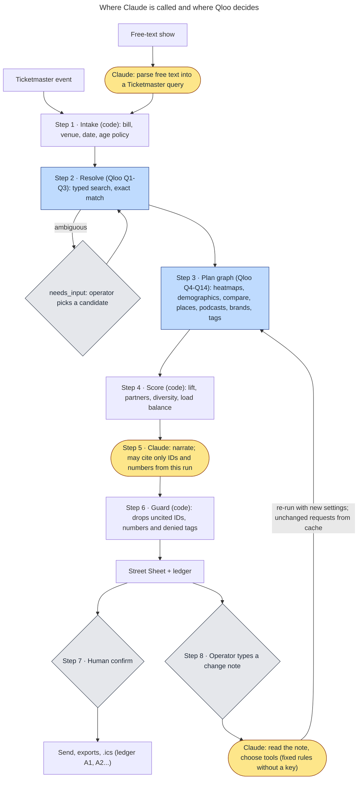

# Walkup

**The Fill-the-Room Agent.** *Fill the room, not the feed.*

For one booked show with seats left, Walkup finds where this bill's crowd stands out from the room's usual crowd, ranks the local places that crowd already likes, and puts them on one page for your street team. Qloo picks the places; Claude writes the sentences and reads your change notes. Every area and partner links to its request.

## Judge it in two minutes

1. **[The Roots' street sheet](https://walkup-eight.vercel.app/plan/fe1ff2bc-9547-4b5c-a69c-f456769afde0)** (The Salt Shed, Chicago, Fri Jan 15 2027). The five areas where The Roots' fans stand out from the room's usual crowd, 22 partners with why each was picked and its hours on the street-team day where Qloo lists them, and, for South Shore, Qloo's most popular places beside Walkup's picks: 1 of the 8 made the list. Every footnote opens the request behind the claim, and the line under the title counts them from the sheet's own ledger (30 Qloo requests of 9 kinds, 2 Ticketmaster requests, 1 Claude call).
2. **[Greensky Bluegrass's sheet after "All ages, no bars"](https://walkup-eight.vercel.app/plan/8439cb36-1252-4678-a8ff-7f19131dc792)**. Claude read the change note as two tool calls (`set_all_ages`, `exclude_partner_categories`), the plan ran again through Qloo and the same code, and the sheet shows the diff: 7 bars and drink-led partners out and 1 restaurant in, the 8 spots near the room replaced by 7, each change with its receipts.
3. **[/eval](https://walkup-eight.vercel.app/eval)**. The live numbers for both rooms, and the Fan-Bar Test, which we ran under a sealed plan and which failed: a football club's Qloo signal found its supporters' bar no more often than Qloo's popularity order (top 50 for 25% of 325 US club-and-city pairs against 27%, p = 0.89). So we don't claim Walkup's picks beat popularity.

From an agent: `claude mcp add --transport http walkup https://walkup-eight.vercel.app/mcp`, then ask for `get_sheet` with plan id `fe1ff2bc-9547-4b5c-a69c-f456769afde0`.

| Criterion | What to look at |
|---|---|
| Technological Implementation | About 30 Qloo requests per sheet of 9 kinds: typed `/search`, `/entities` by Spotify id, `/v2/analysis/compare`, and `/v2/insights` for places, heatmaps, demographics, tags, podcasts and brands ([the calls and why](#qloo-workflows-and-why)). Lift ranks the bill's heatmap against a usual-crowd heatmap built from the venue's own Ticketmaster roster ([`packages/engine`](packages/engine/)). Every claim carries a receipt to its request, and `sheet.json` holds the whole ledger with keys redacted. Claude narrates under a code guard and reads change notes through strict tools, with a rules fallback that needs no key ([`packages/narrator`](packages/narrator/)). An MCP server ([`packages/mcp`](packages/mcp/README.md)) and an Agent Skill ([`skills/walkup`](skills/walkup/SKILL.md)). |
| Design | One page per show for the street team: the web sheet, a one-page PDF, `partners.csv` to call from, `zips.csv` and `pins.csv` for ad platforms, `street-team.ics`. Footnote receipts open a side panel. Status is said in words, and the pages work at 375 px. See [The Roots' sheet](https://walkup-eight.vercel.app/plan/fe1ff2bc-9547-4b5c-a69c-f456769afde0) and its PDF download. |
| Potential Impact | Built for the person filling seats at an independent room, one booked show at a time. Two real rooms (The Salt Shed, Chicago; The Anthem, Washington DC) and four real Ticketmaster bills, run live on Oct 21 2026. 54 of the 74 partners on those four sheets are not among the same number of most popular places in their area (29 of 41 in Chicago, 25 of 33 in Washington). Asked for the same 74 places in the same areas, Claude alone named 5 that Qloo finds there, not marked closed and not a national chain; Walkup's lists have 70 ([/eval](https://walkup-eight.vercel.app/eval#claude-alone)). Nothing here measures ticket sales ([what we measured](#what-we-measured)). |
| Quality of the Idea | Compare each bill with the room's usual crowd, not with everyone: each bill's raw heatmap tracks the room's usual crowd (Spearman 0.31 to 0.66), and lift takes that shared part out. In both rooms the two bills share none of their top 5 areas and none of their partners (the home page's "Same room, two crowds"); raw heat alone also shares no top 5 map square, so that split is not something lift adds ([/eval](https://walkup-eight.vercel.app/eval#live)). The Fan-Bar Test of the partner step is published as a null result ([/eval](https://walkup-eight.vercel.app/eval#fanbar-title)). How it differs from other Qloo projects: [How this differs](#how-this-differs). |

**Try it:** https://walkup-eight.vercel.app (no login). Two real Ticketmaster bills at The Salt Shed, Chicago, run live on Qloo, share none of their top 5 areas and none of their partners: Greensky Bluegrass's crowd stands out most in the suburbs (Schaumburg: 84th percentile for this crowd, 2nd for the room's usual crowd) and The Roots' on the South Side (Bronzeville: 89th against 7th). 29 of their 41 partners are not among the same number of most popular places in their area; in South Shore, only 1 of the 8 most popular places made The Roots' list. A second room, The Anthem in Washington DC, runs the same rule: Rhiannon Giddens' crowd stands out most on H Street NE (82nd against 9th) and FLO's in U Street / Shaw (96th against 3rd), with no top 5 map square and no partner shared; 25 of their 33 partners are not among the same number of most popular places in their area.

Recorded from live Qloo and Ticketmaster runs on Oct 21 2026. Live runs are paused for judging; each recorded sheet comes from a live run, with every receipt and download, and was re-checked offline on Oct 28 to 30 2026 with no API call ("Re-checked offline" under [What we measured](#what-we-measured)); the hosted site calls no API. New plans and searches need your own keys ([setup](#setup-from-a-clean-environment)); a change note on a hero sheet opens a version recorded ahead for that change, most of them on Oct 28 2026; sample mode needs no keys.

Contents: [Judge it in two minutes](#judge-it-in-two-minutes) · [The problem](#the-problem) · [What it does](#what-it-does) · [Qloo workflows and why](#qloo-workflows-and-why) · [A redacted request, end to end](#a-redacted-request-end-to-end) · [What we measured](#what-we-measured) · [Demo without credentials](#demo-without-credentials) · [Setup from a clean environment](#setup-from-a-clean-environment) · [Known limitations](#known-limitations) · [Responsible by construction](#responsible-by-construction) · [How this differs](#how-this-differs) · [Where to look in the code](#where-to-look-in-the-code)

---

## The problem

A promoter or venue marketer has a show on sale, on a fixed date, with seats left. Every week before the show they decide where the street team goes, which local businesses get posters and ticket drops, which podcasts get a pitch, and what the ads say.

The usual inputs:

- **the venue's own email list**, which already reaches the crowd that comes to this room;
- **paid social**, where a location radius is the main local control;
- **a street team working from memory** of what worked for other shows;
- **discounting**, which trains buyers to wait.

None of these answers the question that matters for this one show: *where does this bill's crowd differ from the room's usual crowd, and which real places nearby does that crowd already go to?* That needs aggregate taste data that connects an act to neighbourhoods and to specific local businesses. Qloo has that, and Walkup is built on it.

## What it does

One run produces a **Street Sheet**: nine sections, each with a status (`ok`, `empty`, `needs_input`, `partial`, `degraded`, `error`), a reason when it isn't `ok`, and receipt numbers like `[Q9]` that open the exact request.

1. **Resolution.** The acts and the venue matched to Qloo entities, IDs shown. Ambiguity pauses the run and shows candidates; it is never guessed.
2. **Lift map: where this crowd differs from the room's usual crowd.** The top 5 neighbourhood tiles where this bill's fans over-index versus the fans of the acts this room usually hosts, with the ZIPs in each tile.
3. **Partners for the drop.** 15-25 real places inside the top tiles (16 to 22 on the four recorded live sheets and 10 to 24 on their recorded changes; each recorded note that leaves out place types lists fewer), such as bars, cafes, book stores and barbershops, with address, phone, website, hours on the street-team day and a "Why this place" line, local places before national chains. All of it comes from Qloo's place data; nothing comes from Google. One line says how many of them a list of the most popular places in the same areas would miss, with its receipts. Footer: *Suggested, not affiliated: no partner has agreed to anything.*
4. **Before and after the show.** 6-8 spots within 1.5 km of the venue (2.5 km when fewer than 6 come back), open on show night, load-balanced against assumed capacities you can edit. Alcohol rules come from the Ticketmaster age policy, never from Qloo.
5. **Media and sponsor.** Up to 4 podcasts for a host-read or giveaway pitch (the PDF prints 3 and counts the rest) and one sponsor brand, both labelled national until a check shows location moves the ranking.
6. **Copy hooks.** Three lines built only from allowlisted Qloo tag words. No jokes, nothing in the artist's voice.

Supporting cards: **your own partner list in call order** (the operator's declared partners, scored by Qloo), **how this crowd differs** (bill-versus-house tag contrast) and **the age mix, this bill against the usual crowd** (the gender split stays in `sheet.json`; the page does not show it).

**Change it in plain words.** Type a note about a finished sheet in the "Change something" box on the plan page, such as "All ages: no bars", "skip H Street NE", "only Saturday" or "within 10 km" (or send it to `POST /api/plan/<id>/revise` or the MCP tool `revise_plan`). The note is turned into calls to five tools (mark the show all ages, leave out place types, skip areas on the sheet, set the street-team days, set the search radius from 5 to 60 km), the plan runs again with those settings, and you get a new sheet that lists what changed: settings, areas, partners and spots added or removed, each with receipts. Requests whose inputs didn't change are answered from the cache, so leaving out bars costs no new Qloo call. If the note is unclear, Walkup asks one question and changes nothing. All ages only adds restrictions: when Ticketmaster lists a show as 21+, that still holds, and the sheet treats it as all ages too (no bars, no alcohol in the copy lines, no alcohol, tobacco or gambling sponsor).

Then the action: **Send to street team** opens a confirm dialog listing recipients and attachments. Nothing is sent until you confirm. Exports: the PDF sheet, `partners.csv`, `zips.csv` and `pins.csv` for ad platforms, `street-team.ics`, `offer-codes.csv` (codes you create in your own ticketing platform) and `sheet.json` with the full ledger.

## Qloo workflows and why

Base URL `https://hackathon.api.qloo.com`, header `X-Api-Key`, server-side only. A live hero run makes about 30 Qloo calls; on the sample world a preset makes 16 to 39 from a cold cache (G1-A makes 32, including the signal check, 4 split-half heatmaps, 3 partner usual-crowd searches and 3 popularity searches; G2 makes 39 across its pause, 8 before the pick and 31 after; G3, with no lift map, makes 16). A month guard reads Qloo's `x-month-ratelimit-*` headers (the hackathon key's limit read 50,000 calls a month) and stops fresh runs below 1,500 left. Each call gates one decision; each has a coded fallback whose reason shows on its card.

| Call | Request shape (abridged) | Decision it gates | Calls per run |
|---|---|---|---|
| Q1 | `GET /entities?external.spotify.ids=` from Ticketmaster attractions, else typed `GET /search?types=urn:entity:artist,urn:entity:person&take=5`, exact name match; then one signal check: `filter.type=urn:entity:place` with every seed as `signal.interests.entities`, `POINT(venue)`, 1,500 m, `take=1` | Whether the run proceeds and which acts are admissible seeds; ambiguity returns `needs_input` with candidates. An entry Qloo has no taste data for (a `not_found` warning) is swapped for the next usable entry of the same search, asked about, or left out, and the sheet says which | 2-5 (the check is one call per 25 ids, plus one per Spotify-matched act Qloo drops; a 200 is cached 7 days, a 400 is not) |
| Q2 | `GET /search?types=urn:entity:place` near the venue's coordinates, exact | The venue's place ID (excluded from partners; distance anchor). Not in the catalog yet: `POINT(lon lat)` from Ticketmaster | 1 |
| Q3 | The venue's next 60 Ticketmaster events, resolved via `GET /entities?external.spotify.ids=`, then typed `GET /search` for up to 6 headliners it missed | **The house set**: the room's top 12 resolved headliners. Fewer than 5: no genre tag is pinned as a stand-in, so the sheet has no lift map (`baseline: "none"`); comedy never gets one | Up to 7 (1 `/entities`, then up to 6 `/search`; 7 on each live sheet), weekly per venue |
| Q4 | `GET /v2/insights?filter.type=urn:heatmap&signal.interests.entities=<bill>&filter.location=POINT(lon lat)&filter.location.radius=40000` | Bill heat per geohash | 1 (+1 when fewer than 200 map squares come back and the map is searched again at 60 km; 2 on FLO's sheets) |
| Q5 | Same heatmap with the house set as the signal | House heat per geohash (the denominator of lift) | 0-1, weekly per venue |
| Q6 | Same heatmap with a pinned restaurant tag as the signal | Diagnostic: is lift just foot traffic? | 0-1 |
| Lift | No API call: (bill percentile + 50) / (usual-crowd percentile + 50) per geohash-6, so lift stays between 1/3 and 3, shrunk toward 1 where popularity is low | **Where** the street team goes and which tiles get partner searches | 0 |
| Split-half | The Q4 and Q5 heatmaps again at the same point and radius, each with one half of the bill's seeds and one half of the house set (the house set is split only when it is the baseline and has 2 or more ids) | Whether the map holds up when the bill is split in two: a split-half Spearman of 0.5 or less ranks partners near the venue | 0-4 (none when the bill has one seed; 0 on the live sheets) |
| Q7 | `filter.type=urn:demographics` over bill and house (one block per entity) | Bill-versus-house age mix for creative and dayparting (the gender split is kept in `sheet.json`, not shown). Never used for alcohol, radio format or community inference | 1 |
| Q8 | `GET /v2/analysis/compare?a.signal.interests.entities=<bill>&b.signal.interests.entities=<house>&take=30` | "How this crowd differs"; side-`a` tags become copy-hook candidates. Generic result: two `urn:tag` calls diffed by rank, `degraded` | 1 (+2) |
| Q9 | `filter.type=urn:entity:place` per top tile: `signal.interests.entities=<bill>`, `filter.location=POINT(tile)` 2 km, pinned `filter.tags` with `operator.filter.tags=union`, `filter.hours=<street-team day>`, `filter.price_level.max=3`, `filter.exclude.tags`, `filter.exclude.entities=<venue>`, `feature.explainability=true`, `take=50` | **The 15-25 ticket-drop, poster and call partners** | 1-3, one per partner area (+1 for an area that returns fewer than 8 places and is searched again at 3,500 m, +1 more with more place types if it is still short; 3 or 4 on the live sheets) |
| Q9 house twin | The same request per pool with the room's usual crowd as the signal, no explainability | Marks down places the usual crowd likes as much | 0-3 |
| Q9 popularity twin | The same request per pool that gave partners, with no `signal.interests.entities` and no explainability; Qloo answers it in popularity order (probe 1, Oct 15) | Nothing on the list: it measures how many partners a popularity list of the same length would miss ("12 of the 19 partners aren't among the most popular places in their areas, so a popularity list would miss them."). Failed or empty: no number, and the steps say why | 0-3 (one per pool that gave partners; 2 or 3 on the live sheets) |
| Q10 | Place search at the venue, 1.5 km, restaurant/bar/cafe, show weekday, `take=25`, no price cap; a weekly house-signal twin | The 6-8 pre/post spots and their rank against the usual crowd ("ranks 3 places higher here than for the room's usual crowd") | 1 (+1 when fewer than 6 spots come back within 1.5 km and the search widens to 2.5 km; +1 weekly house twin) |
| Q11 | `filter.results.entities=<operator's partners>` with the bill as the signal | Call order for the operator's own list; partners not in the catalog stay on the list, "not in Qloo's catalog, kept in your order" | 1 (+1 pick-list search per typed partner, cap 20) |
| Q12 | `filter.type=urn:entity:podcast` with `signal.location=POINT(venue)`, explainability, `take=15` | Which podcasts get a pitch; labelled national until a check shows location moves the ranking | 1 |
| Q13 | `filter.type=urn:entity:brand` with `signal.location`, explainability, `take=15`; on shows that aren't 21+ or that the operator marked all ages, brands whose name or tags point to alcohol, tobacco or gambling are left out | One sponsor card, labelled national | 1 |
| Q14 | `filter.type=urn:tag` with `filter.tag.types=urn:tag:keyword:media,urn:tag:genre:music,urn:tag:theme:qloo,urn:tag:audience:qloo`, `diversify.by=subtype`, `take=30` | The copy allowlist, after the denylist | 1 |
| Q16 | `GET /v2/tags?filter.query=...&feature.semantic_search=true` | Pins tag IDs in [`config/tags.json`](config/tags.json) at build time; zero free-text tags at runtime | 0 at runtime |

**Why these shapes:** typed `/search` with `needs_input`; `/entities` by external ID; a lift heatmap over a house baseline built from the venue's own roster; multi-block `urn:demographics`; `/v2/analysis/compare`; stacked-constraint place insights with explainability; `filter.results.entities` shortlist scoring; `signal.location` on podcasts and brands; `urn:tag` with namespace scoping and `diversify.by=subtype`. `/v2/tags` pins tag IDs ahead of time, never during a run. Every Qloo call is a GET with plain entity ids: weighted POST signals returned 400 on Oct 15, so nothing weights one act against another.

**The house baseline.** A raw heatmap partly follows where people are and who already comes to the room: on the four live bills, each bill's raw heat correlates 0.31 to 0.66 (Spearman) with the room's usual crowd. Walkup compares the bill's heat with the heat of the acts this room usually hosts, built from the venue's own upcoming Ticketmaster roster: per map square, lift is (the bill's percentile + 50) / (the usual crowd's percentile + 50), pulled toward 1 where data is thin. What's left is where *this* bill's crowd over-indexes versus the room's usual crowd: the people the venue's list probably hasn't reached. Affinities are compared only as percentile ranks inside one response, never across calls. Two checks guard the map. If lift tracks general foot traffic too closely (Spearman above 0.9 against a restaurant heatmap), the map shows a `lift weak` badge. If lift ranks areas almost like the bill's own map (Spearman above 0.9), the card says the map shows where this crowd is, not where it stands out; a comedian's map against the restaurant baseline scored 0.98 on Oct 15. Either way, partners fall back to near-venue ranking.

**Deterministic scoring.** Partner score inside a tile is `(1 - (qloo_rank - 1) / n) × (tile lift / max lift)`, with at most 2 partners per category per tile, at least 1 non-bar per tile when the area has an eligible one, at most 8 per tile, ties broken by distance, closed places dropped and hours checked against the street-team day. National chains (Starbucks, Popeyes, Panera Bread and the like, spotted from a hand-kept list in [`config/chains.json`](config/chains.json), Qloo's description of the place, a store-locator website, or the same name or website at 3 or more places) are listed after every local place of their area, and kept only for a slot no local place can fill; the same goes for the spots near the venue. The card says how many partners are chains and how many more were left off ("2 of 16 partners are national chains, listed last in their area: no local place filled their slot. 12 more chains left off: 10 for local places, 2 by the limit of 2 per list."), and the steps name the chains left off. Code ranks; the model does not.

### Verified on hackathon.api.qloo.com, Oct 15 2026

Each request shape a run sends, checked against the live host on Oct 15 2026 (the day-one probes plus a few single checks). Only derived facts are listed: statuses, counts and field names, no response data. **Verified** means the shape answers as we use it; **changed** means the check changed what we send or how we read it; **added** is new because of a check; **removed** means the code path is gone.

| Request shape we send | Used for | What the live host did | Status |
|---|---|---|---|
| `GET /search` `types=urn:entity:artist,urn:entity:person`, `take=5`, exact name | Acts (Q1), the room's usual acts (Q3) | 200. Most musicians are listed twice under one exact name, an artist entry and a person entry; the run now counts them as one act | verified, changed |
| `GET /v2/insights` `filter.type=urn:entity:place`, the seeds as `signal.interests.entities`, `filter.location=POINT(venue)`, 1,500 m, `take=1` | Signal check (Q1): one call per 25 ids, plus one per Spotify-matched act Qloo drops (a 200 is cached 7 days, a 400 is not) | 200 with a top-level `not_found` warning naming each seed Qloo has no taste data for ("Jason Isbell" was one; "Jason Isbell and The 400 Unit" works) | added |
| `GET /search` `types=urn:entity:place`, `filter.location=<lat>,<lon>`, `filter.radius` in miles | Venue (Q2), pick list for your partners (Q11) | 200; a room was found 5 m from its point within 1 mile; another room is not in the catalog | verified |
| `GET /entities?external.spotify.ids=` | Acts and the room's roster by Spotify id (Q1, Q3) | 200; the ids come back under `properties.external` | verified, changed |
| `filter.type=urn:heatmap`, `signal.interests.entities`, `filter.location=POINT`, `filter.location.radius` | Bill and usual-crowd maps (Q4, Q5), the split-half check | 200; the radius is honoured; a seed Qloo has no taste data for is dropped with no warning, and a map of only such seeds still comes back (200, with cells), which is why the signal check exists | verified |
| `filter.type=urn:heatmap` with a pinned place tag (restaurant) as the signal | Popularity check (Q6) | 200 | verified |
| `filter.type=urn:heatmap` with a genre tag as the signal | Genre baseline when the roster is short (Q5) | The stand-up comedy tag returned 0 areas near a comedy club. Music genre tags are not checked, so none is pinned | changed: no comedy baseline |
| `filter.type=urn:demographics` | Age mix (Q7) | 200; one block per signal, 6 age buckets, 2 gender keys | verified |
| `GET /v2/analysis/compare` `a.signal.interests.entities`, `b.signal.interests.entities`, `take=30` | How this crowd differs (Q8) | 200; `take` has no effect, so each list is cut on our side | verified, changed |
| `filter.type=urn:entity:place` per area: `filter.location` and radius, `filter.tags` with `operator.filter.tags=union`, `filter.hours`, `filter.price_level.max`, `feature.explainability`, `take=50` | Partners (Q9) and their usual-crowd twin; spots near the venue (Q10) use the same filters without `filter.price_level.max` and with `take=25` | 200; `filter.hours` is honoured (5 places closed that day without it, 0 with it). `filter.exclude.tags` and `filter.exclude.entities` were not checked separately | verified |
| `filter.tags` with pinned category tags | Partner and spot categories (Q9, Q10) | 11 of 14 categories pinned (6 to 10 places within 25 km, every one carrying the tag); record store, Irish pub and place of worship returned too few and are not used | verified, changed |
| `filter.results.entities` with the bill as the signal | Call order for your partners (Q11) | 200; a 10-entity shortlist came back fully scored | verified |
| `filter.type=urn:entity:podcast`, `signal.location=POINT(venue)`, `feature.explainability`, `take=15` | Podcasts (Q12) | 200, 15 rows with a usable seed. The day-one 400s came from a seed Qloo had no taste data for. Whether location moves the ranking is not shown, so podcasts stay labelled national | verified |
| `filter.type=urn:entity:brand`, `signal.location=POINT(venue)`, `feature.explainability`, `take=15` | Sponsor (Q13) | 200, 15 rows with a usable seed. No alcohol brand tag was found to exclude, so on shows that aren't 21+ or that the operator marked all ages a name and tag filter keeps alcohol, tobacco and gambling brands off | verified, changed |
| `filter.type=urn:tag`, `filter.tag.types`, `diversify.by=subtype`, `take=30` | Copy-line tags (Q14) | 200; `diversify.by=subtype` keeps at most 5 tags per namespace | verified |
| `GET /v2/tags` `filter.query`, `filter.parents.types=urn:entity:place`, `feature.semantic_search=true` | Pinning tag ids (build time) | 200 | verified |
| `POST /v2/insights` with `{entity, weight}` signals | Weighting an act against its stand-ins | 400 | removed |
| `filter.results.entities.query` (place names instead of ids) | Scoring a typed list without a pick list | 400 | removed, never sent |
| `signal.demographics.age` on place calls | Age-tuned partner ranking | No change in the top 10, but the test ran on a seed Qloo had no taste data for, so it shows nothing | removed, never sent |
| `GET /v2/audiences` `filter.query` | Declared group segments | 0 results for both test queries | removed |

### Where Claude is called and where Qloo decides



Claude is called at three points only: parsing free text into a Ticketmaster query, narrating the finished sheet, and reading a change note. By default it is Claude Haiku 5.5 through OpenRouter (`anthropic/claude-haiku-5.5`); with an Anthropic key and no OpenRouter key, or with `WALKUP_LLM_PROVIDER=anthropic`, it is Claude Opus 5.5 (`claude-opus-5-5`) through the Anthropic API. For a change note it sees a short summary of the sheet (areas, place types, settings; no partner names or contacts) and chooses among strict tools whose allowed values come from that sheet; it can also ask one question instead. It never ranks places: the tools only set inputs, and the plan runs again through Qloo and the same code. Without a model key, or when the call fails, fixed rules read common notes ("all ages", "no bars", "skip <area>", "only Saturday", "within 10 km") into the same tool calls, the sheet says the rules read it, and anything else gets a question. Narration is schema-constrained: each field can reference only the entity IDs and numbers returned in this run, and a validator drops anything else and shows the count.

## A redacted request, end to end

This is the partner call behind the hero sheets, shown as its redacted shape (checked against the live host on Oct 15), with what the code does with the answer. Qloo response bodies are never committed, so no response is shown.

```http
GET /v2/insights
  ?filter.type=urn:entity:place
  &signal.interests.entities=<bill entity IDs from Q1>
  &filter.location=POINT(<tile lon> <tile lat>)
  &filter.location.radius=2000
  &filter.tags=<pinned category URNs from config/tags.json>
  &operator.filter.tags=union
  &filter.hours=<street-team weekday>
  &filter.price_level.max=3
  &filter.exclude.tags=<pinned night club URN, unless Ticketmaster lists the show as 21+ and the operator has not marked it all ages>
  &filter.exclude.entities=<venue entity ID from Q2>
  &feature.explainability=true
  &take=50
Host: hackathon.api.qloo.com
X-Api-Key: $QLOO_API_KEY
```

From each row of `results.entities` the code reads the entity ID, name, location, tags, `query.affinity`, `query.distance`, `query.explainability` and the `hours`, `is_closed`, `address`, `phone` and `website` properties. Closed places and places shut on the street-team day are dropped and counted, denied tags are stripped, and the rest are scored inside their tile with the diversity rules above. The same request then runs once more per area with the room's usual crowd as the signal (places that crowd ranks as high are marked down) and once with no signal (the popularity check). The ledger keeps each request with the key replaced by `$QLOO_API_KEY`, the status, latency, result count and cache flag, and every partner on the sheet points back to it as `[Qn]`.

The field-by-field mapping from our inputs to Qloo parameters and back is in [docs/mapping-table.md](docs/mapping-table.md).

## What we measured

### Live, recorded Oct 21 2026

Recorded on the hosted site from live Qloo and Ticketmaster calls on Oct 21 2026 (30 and 22 new Qloo calls, the second run reusing cached answers; the sheets were then run again the same day from those cached answers with the final rules, with 0 new Qloo calls). A fixed rule from the spec picks the bills: in one independent room, the first Americana, country or folk bill in the window, and the bill in that window whose genre is most distant from it ([`HERO_RULE`](packages/orchestrator/src/presets.ts)). Here the room was The Anthem, Washington DC (I.M.P.), and the window Dec 20 2026 to Feb 28 2027. On The Anthem's Ticketmaster calendar, Rhiannon Giddens (Sun Feb 28 2027) was the only Americana, country or folk bill in that window, so she is bill A; FLO's R&B show (Wed Feb 17 2027) was the most distant genre. No bill was skipped.

- **Two bills, two crowds.** The two sheets share none of their top 5 areas and none of their suggested partners (16 and 17). Giddens' crowd stands out most on H Street NE (82nd percentile for this crowd, 9th for the room's usual crowd; lift 2.2); FLO's in U Street / Shaw (96th against 3rd; lift 2.8). By place rather than map square (within 3 km or a shared ZIP), Giddens' H Street NE and FLO's Langdon overlap.
- **Popularity check.** For each area, the same Qloo place search without the bill as the signal, which Qloo returns in popularity order, cut to the same length as the partner list there. 10 of Giddens' 16 partners and 15 of FLO's 17 are not in the popularity list for their area: 25 of 33 overall. It compares two lists, not ticket sales.
- **A change note.** "All ages, no bars" on FLO's sheet: Claude (Haiku 5.5 through OpenRouter; an earlier run on Oct 20 with Opus 5.5 made the same calls) read it as two tool calls (`set_all_ages`, `exclude_partner_categories`). 5 partners were removed (the bars and lounges), and the re-run made 0 new Qloo calls (30 answered from cache). [The revised sheet](https://walkup-eight.vercel.app/plan/57cd1eda-95bd-4917-a3a7-13b4d7bedb51) shows each removal with its receipts.
- **A partial map.** FLO's map is marked partial: only 131 map squares came back within 40 km (fewer than 200), so the search widened to 60 km, and only 159 came back there. Some suburban areas still carry national chains when no local place fits; they are listed after local places and labelled.
- **Is lift just foot traffic?** A separate check on Oct 20 2026 at another room, with the real Ticketmaster roster of The Truth, Nashville: rank agreement (Spearman) between lift and raw heat 0.20 and 0.01 (must be below 0.8), and overlap (Jaccard) of two bills' top tenth of areas 0.47 (must be below 0.5). Pass. It says lift is not just foot traffic for that pair, at one room.
- **With Qloo and without, by name.** Each live sheet shows one area's two lists side by side, next to the partner table: the places most popular there for any crowd (the no-signal search) and Walkup's picks there for this show's fans, with each pick's rank for this crowd and for the room's usual crowd. The area is the one where the most picks are missing from the popularity list. Giddens, H Street NE: 2 of the 7 most popular places made her list. FLO, Laurel, MD: none of the 8 (on FLO's sheet). The home page shows The Roots' South Shore table and Giddens' H Street NE table.
- **API notes we handled.** In the recorded live responses, explainability shares can sum to less than 1 (0.936 seen), so the sheet uses them only to name the act behind a place; a demographics call can leave out an act Qloo has no age data for, so the age card is marked `partial` and names it. Found on Oct 15: an exact `/search` hit can be an entry Qloo has no taste data for ("Jason Isbell", where "Jason Isbell and The 400 Unit" works), and heatmaps drop such ids quietly, so a signal check runs before planning and swaps in the next usable entry.

### A second room: The Salt Shed, Chicago, recorded Oct 21 2026

The same rule and window at an independent room in another city: The Salt Shed's indoor Shed in Chicago (capacity 3,600), owned and run by 16" On Center, the Chicago group behind the Empty Bottle and Thalia Hall, and a member of the [Chicago Independent Venue League](https://www.civlchicago.com/). Ticketmaster lists 36 of the room's next 44 shows as promoted by the venue, both picks among them. Run with `npm run tm:room -- --venue-id=KovZ917AI5F --as-of=2026-10-21 --package=vvG18Z_CM8Huwe`. The first listing in the window is a two-night pass for Greensky Bluegrass's Dec 30 and 31 shows; the rule skips a ticket package as not a show of its own, so bill A is Greensky Bluegrass on Wed Dec 30 2026 (bluegrass). Bill B is The Roots on Fri Jan 15 2027 (hip-hop), the most distant genre. Greensky Bluegrass matched Qloo by Spotify id; The Roots' Spotify id on Ticketmaster is not in Qloo, so they matched by an exact name search with one result. The room's usual crowd is 12 headliners from its next 44 Ticketmaster shows. The two runs made 50 new Qloo calls (29 and 21). After the promoter's read below, the sheets were run again with the fixes; the room now matched Qloo under its everyday name, which changed the place searches, so that run made 23 new calls. "All ages, no bars" on Greensky Bluegrass's sheet made 9. Choosing the room cost 14 more: Qloo matches and map sizes for candidate bills at Thalia Hall and The Salt Shed.

- **Two bills, two crowds.** The sheets share none of their top 5 areas and none of their suggested partners (19 and 22). Greensky Bluegrass's crowd stands out most in the suburbs: Schaumburg, 39 km west (84th percentile for this crowd, 2nd for the room's usual crowd; lift 2.6), then Highwood and Oak Park. The Roots' crowd stands out most on the South Side: Bronzeville, 9.9 km south (89th against 7th; lift 2.4), then Midlothian and South Shore. Neither sheet is marked thin.
- **Popularity check.** 12 of Greensky Bluegrass's 19 partners and 17 of The Roots' 22 are not in the popularity list for their area: 29 of 41. In South Shore half the popularity list is national chains (Starbucks, Popeyes, Burger King and Church's Texas Chicken); only The Woodlawn is on both lists. The Roots' picks there include Jeffery Pub, Supreme Bean Pie and Give Me Some Sugah. In Oak Park, 2 of the 8 most popular places made Greensky Bluegrass's list, FitzGerald's (a Berwyn roots-music club) among them.
- **A change note.** "All ages, no bars" on Greensky Bluegrass's sheet: Claude read it as two tool calls (`set_all_ages`, `exclude_partner_categories`). 7 bars and drink-led partners came off and one restaurant came on (19 to 13 partners), and all 8 pre- and post-show spots came off for 7 others: five restaurants, a cafe and a bakery (Mariano's, a national chain, listed last). With 13 partners the revised sheet is below the 15 the list aims for, so it says to "treat this as a starting list".
- **Read as a promoter would.** Every partner row was checked by hand for type, hours, website and area name. That check dropped a food-truck business whose address reads "RESTAURANT CLOSED" (the closed check now reads the address, and "Food Trucks" counts as a food stand), added two Chicago grocery chains (Mariano's, Jewel-Osco) to the chain list, and added Chicago area names locals use (South Shore, Auburn Gresham, Chatham, Woodlawn) to the new Chicago gazetteer in place of subdivision names from OpenStreetMap.

**Re-checked offline, Oct 28 to 30 2026.** The recorded sheets were held to the newer checks with no API call (`recheckSheet`, run by `scripts/refresh-recorded-plans.ts --recheck`). 16 Claude sentences that fail a check now read as template wording, with the reason in the sheet's checks: a partner line that called a place 35 km away close to the room, a line that merged split opening hours, two summaries that said where the crowd lives or which side of the city it is on, the ten the fourth pass below found and the two the fifth pass found. Partner lines that put a place "in" or "on" its area now say "near" it, unless the area is a street the address is on. Each area carries its own state, from its own point (Georgetown is DC). "Record stores isn't searched yet" reads "aren't", and the Checks step says why each dropped line went. Each revision's change list was rebuilt against its parent over the five numbered areas, so a skipped area now names the area that took its place. On the two "All ages, no bars" revisions at The Salt Shed, one spot listed as a restaurant, SWIG, is a bar by its Qloo tags (a bar and grill, with dive-bar tags) and was left out, so each lists 7 spots. FLO's "Within 10 km of the room" revision changed nothing and was removed. A second pass on Oct 29 gave Thurst Lounge on FLO's sheet back the kind its run picked it under, a bar (a later re-read of its stored tags, which the data policy had already trimmed of the bar tags, called it a restaurant, a third in U Street / Shaw), dropped four partner website links that no longer work (checked Oct 29), showed four places' own websites whose domain shortens the name, made "and N more" in chain lists count places, said a partner chain is listed last in its area (not last on the whole list), had the Summary and Checks steps say when fixed wording replaced Claude's lines, wrote "15 partner lines trimmed" for "15 partner line(s) trimmed" and "1 of 1 act resolved" for "1 of 1 acts resolved", named the shared-website signal in the chain note, and removed a repeated label from 16 Ticketmaster roster receipts. A third pass on Oct 29 made every "about N times" follow one rule (the sheet's 2-decimal lift, rounded half up), so an area reads the same figure on the plan page, the PDF, the Steps panel and street-team.ics: an area at lift 2.15x on two of The Roots' revisions now reads "About 2.2 times" (was 2.1), the Steps panel of Greensky Bluegrass's "Skip Schaumburg" revision says "Put Highwood first: about 2.5 times" (was 2.4, against 2.5 on the same page), and the change list of FLO's "Skip U Street / Shaw" revision gives Downtown Silver Spring "about 1.7 times" (was 1.6). A fourth pass on Oct 29 held Claude's lines to newer checks, and ten more now read as template wording: six partner lines that called a partner a stop before or after the show, though it is not on the sheet's spots list near the room; a summary that called an area's places spots; a summary that named three areas where the crowd stands out most, though Buzzard Point stands out more than one of them; an area line that put Kenilworth at the 81st percentile, where the sheet has the 80th; and an area line that called South Loop's budget share equal to the others', where the shares differ. The same pass wrote "an 82nd" and "an 80th" for "a 82nd" and "a 80th", and "about 2.0 times" for "about 2 times" in the eight Claude area lines on Bethesda and Greenbelt (lift 2.04x), the figure the rest of the sheet and street-team.ics print. It also dropped two fan copy lines that called the room "cozy" or "intimate", words from the crowd's taste tags rather than about the room, on two revisions of Rhiannon Giddens at The Anthem ("All ages, no bars" and "Street team only on Saturday"); each now lists 2 copy lines. A fifth pass on Oct 30 fixed wording that the rest of its sheet contradicts: the lift card's count of areas now names its two tests (lift 1.3 or more, percentile 70 or higher), where it said every area where this crowd ranks higher than the room's usual crowd; the top pick on FLO's "Skip U Street / Shaw" revision says "national chains aside", since a national chain in Laurel ranks higher for this crowd; Claude's summary on that revision says "R&B" for Ticketmaster's "Music / R&B"; the Summary step on the two Rhiannon Giddens revisions above no longer says Claude wrote 2 fan copy lines (it wrote 3, and the checks kept 2), and their Checks step counts the dropped "cozy" or "intimate" line as a claim the run didn't back (it said "for other checks listed under Checks"); and two more Claude sentences now read as template wording: an area line on Greensky Bluegrass's "Skip Schaumburg" revision that called Downtown Evanston "the area with the 96th percentile for this crowd among the lifted areas", where South Loop, on the same list, is at the 100th, and Claude's summary on The Roots' "Skip Bronzeville" revision, which said the crowd stands out in five areas where the lift card counts 66 that pass both tests. The same pass held the sheets to three newer rules. On two of the four "No restaurants" revisions, a partner whose name says restaurant is now left out: Right Spot Restaurant & Bar (a lounge by its tags) on FLO's and La Parra Restaurant & Bar (a wine bar by its tags) on Greensky Bluegrass's, so each lists 13 partners, and its counts, popularity check, change list and checks follow. A department-store tag alone no longer makes a place a clothing store: Walmart Neighborhood Market on The Roots' "Skip Bronzeville" revision is now a bakery, by its own tags, with a bakery's ask. The fixed-wording summary now says the crowd stands out "in the sheet's top 5 areas" (21 sheets), since the lift card counts more areas that pass both tests. No Qloo or Ticketmaster answer, ledger number or ranking of the places kept changed.

### The Fan-Bar Test, run Oct 21 2026: no better than popularity

A held-out test of the one hop Walkup rests on, that a Qloo signal finds where a crowd gathers. Football supporters' clubs list their official bar in each US city. We gave Qloo the club as the signal (Arsenal FC, Liverpool FC, the US men's national team) and asked for the top 50 bars and pubs within 25 km of the city, then asked again with no signal, which Qloo returns in popularity order. The plan, the metric and the pass mark were hashed on Oct 13 before any call ([`docs/preregistration/`](docs/preregistration/)); the changes made before the run (no Google Places arm, no model arm, the `/search` location format) are in its [deviations log](docs/preregistration/p1-deviations.md). 1,146 Qloo calls.

- **Result: the test fails.** In 325 club-and-city pairs across 225 US cities, the club's signal put its official bar in the top 50 for 25% of pairs (95% CI 21% to 30%); popularity alone did for 27% (22% to 32%). Mean reciprocal rank 0.024 against 0.030, a difference of -0.006 (95% CI -0.018 to 0.006), one-sided Wilcoxon p = 0.89. 343 of 426 listed bars were analyzed (72 did not resolve to a Qloo place, 10 were beyond 25 km, 1 had no city point).
- **Derby Test.** Where two clubs list a bar in the same city, the club's own bar ranked above its rival's in 95 of 182 trials: 52% (95% CI 45% to 60%), p = 0.30. No better than a coin flip.
- **What it means.** A club's taste signal did not find that club's bar better than popularity. Walkup's signal is a show's acts, not a club, and the test did not measure lift, but nothing here shows its picks beat popularity, so the product does not claim it. Each sheet states this result once, in its limits, with its scope, its numbers and a link to /eval, and each partner table carries the banner the sealed plan commits to for this outcome: "Ranked by Qloo affinity; our test did not show this beats popularity." Not run: the model-with-Google-Places arm (Google billing closed) and the model-only arm; closed bars could not be checked. Full numbers: [`evals/p1/results.md`](evals/p1/results.md).

### On sample data

- **Product eval, 20 cases, on sample data.** Four goldens and sixteen scenario cases (the `needs_input` pause, thin heatmaps, empty compare, closed places, missing hours, the all-ages rule, quota and rate limits and more) run end to end through the orchestrator on the synthetic stand-in, with grounding, ledger, budget and policy checks. All 20 pass; CI re-runs them on every push and, on the main branch, commits the score to [`evals/product/out/score.md`](evals/product/out/score.md) when anything in it other than its timestamp changes. This checks that the pipeline behaves as described. It says nothing about whether Qloo's picks are better than another list.
- **Popularity check, on every sheet.** The partner card states the count in one sentence with its receipts, and `sheet.json` carries it as `popularityCheck`. On the sample sheets the numbers are made up with everything else (G1-A: 18 of 24); the live numbers are above.

What we tried and dropped is in [docs/what-we-tried.md](docs/what-we-tried.md).

## Demo without credentials

**Hosted, recorded mode.** https://walkup-eight.vercel.app needs no login and no keys:

- The home page opens with a screenshot of The Roots' sheet and one button to it, then The Salt Shed's two bills side by side, then The Roots' and Rhiannon Giddens' with-and-without tables, then The Anthem. Open [Greensky Bluegrass's sheet](https://walkup-eight.vercel.app/plan/455629e6-ec44-4494-a69b-6154e4433c65), [The Roots' sheet](https://walkup-eight.vercel.app/plan/fe1ff2bc-9547-4b5c-a69c-f456769afde0) or [Greensky Bluegrass's sheet after "All ages, no bars"](https://walkup-eight.vercel.app/plan/8439cb36-1252-4678-a8ff-7f19131dc792). Every footnote opens the request behind it (endpoint, parameters with the key redacted, status, cache flag).
- The second room, The Anthem, Washington DC: [Rhiannon Giddens' sheet](https://walkup-eight.vercel.app/plan/1cfdc829-7814-4759-a624-9047a53994b7) and [FLO's sheet](https://walkup-eight.vercel.app/plan/afc936c1-21cf-4846-a21e-9f5d39c2a58a).
- The [FLO sheet after "All ages, no bars"](https://walkup-eight.vercel.app/plan/57cd1eda-95bd-4917-a3a7-13b4d7bedb51) lists what changed and Claude's tool calls on the ledger (`L1`).
- Downloads work: the PDF, `partners.csv`, `zips.csv`, `pins.csv`, `street-team.ics`, `offer-codes.csv` and `sheet.json`. Send to street team opens the confirm dialog with the real preview; the host has no email key, so nothing leaves it ("demo: not sent").
- The Hampton Coliseum and Super Funny, Tacoma presets are sample sheets, labelled sample: invented bills on a synthetic stand-in for Qloo and Ticketmaster.
- New plans and searches answer 503 with the reason. A change note on a hero sheet opens the version recorded ahead for the same change (the ready-made changes are listed under the box); any other change answers that it needs new Qloo requests. `/healthz` reports the mode and the recorded run behind each preset.
- From an agent: `claude mcp add --transport http walkup https://walkup-eight.vercel.app/mcp`, then `get_sheet` or `bill_vs_house` with a plan id above. `rank_partners`, `revise_plan` and new plans answer that the server serves recorded sheets only; `revise_plan` also names the plan's recorded revisions, readable with `get_sheet`.

**Local, sample mode.** Clone and run with an empty `.env` ([next section](#setup-from-a-clean-environment)). With no Qloo or Ticketmaster key, the four presets run end to end through the same orchestrator on the synthetic stand-in (`packages/qloo-world`, no network), and every page, file and email says it is sample data. The Hampton Coliseum preset pauses on a one-word act name and asks you to pick, and change notes are read by the fixed rules.

## Setup from a clean environment

Requirements: **Node 22+** and npm. Python 3.11 only for the evals.

```bash
git clone https://github.com/TAUIL-Abd-Elilah/walkup.git
cd walkup
npm ci
cp .env.example .env        # Windows: copy .env.example .env
npm run dev                 # http://localhost:3000
```

With `WALKUP_MODE=auto` (the default) and blank keys, the app runs in sample mode. Free-form show search is disabled there, with an explanation. When live runs are paused (`WALKUP_MODE=recorded`, or the time in `WALKUP_QLOO_UNTIL` has passed), the server serves the sheets it stored on earlier live runs, dated and labelled as recordings, and makes no new plans ([`docs/deploy.md`](docs/deploy.md#recorded-mode-live-runs-paused)). To run live, fill in `.env`:

| Variable | Used for | Without it |
|---|---|---|
| `QLOO_API_KEY` | Every Qloo call. Server-side only, never sent to the browser | Sample mode |
| `QLOO_BASE_URL` | Defaults to `https://hackathon.api.qloo.com` | |
| `TICKETMASTER_API_KEY` | Event lookup, venue coordinates, age policy, venue roster | Sample mode |
| `OPENROUTER_API_KEY` | Narration, free-text parsing and change notes, through OpenRouter with Claude Haiku 5.5 (`anthropic/claude-haiku-5.5`; `OPENROUTER_MODEL` overrides). Used first when set. No server-side refusal fallback on this route (see `packages/narrator/README.md`, "Providers") | Uses `ANTHROPIC_API_KEY` if set |
| `ANTHROPIC_API_KEY` | The same calls through the Anthropic API with Claude Opus 5.5 (`claude-opus-5-5`), with the server-side refusal fallback. Used when no OpenRouter key is set, or when `WALKUP_LLM_PROVIDER=anthropic` | With neither key, narration falls back to a labelled template and change notes are read by fixed rules |
| `CENSUS_API_KEY` | Live ACS lookups (`packages/acs`); no product step makes one | Adult counts come from the bundled gazetteer |
| `RESEND_API_KEY`, `RESEND_FROM` | The confirm-gated send | The preview and the ledger entry are real, but nothing is sent ("demo: not sent") |

No Google key is read: the product makes no Google request.

Checks (the same ones CI runs):

```bash
npm run typecheck
npm test
node --test "skills/test/*.test.mjs" "config/test/*.test.mjs"
node scripts/check-no-raw.mjs           # no Qloo response bodies in the tree
(cd apps/web && npx next build)
python -m pip install -r evals/requirements.txt
python evals/p1/test_analyze.py && python evals/p1/test_collect.py   # or, with pytest installed: python -m pytest evals
python data/gazetteer/test_build.py     # offline
```

In a fresh clone `npm test` reports 31 skipped. Nine are in `packages/qloo/test/recorded.test.ts`, which replays recorded Qloo response bodies kept out of git (`fixtures/raw/` is git-ignored and `scripts/check-no-raw.mjs` fails CI if one is committed). The other 22 read the hosted sheets in `deploy/vercel/plans.json`, which is git-ignored and ships only with a deploy: four in `apps/web/test/web-fixes.test.ts`, three each in `apps/web/test/web-r3-fixes.test.ts` and `packages/exports/test/r8-ics-shift.test.ts`, two each in `apps/web/test/mcp-fixes.test.ts`, `apps/web/test/print-view.test.ts`, `apps/web/test/web-r8-fixes.test.ts` and `packages/exports/test/recorded-plans.test.ts`, and one each in `apps/web/test/exports-route-note.test.ts`, `apps/web/test/web-r2-fixes.test.ts`, `apps/web/test/docs-r6-fixes.test.ts` and `apps/web/test/judging-fixes.test.ts` (which also needs that file's pre-recheck copy in the git-ignored `.cache/backup/`). One more test (`evals/p1/arms`) skips if Python lacks numpy and scipy, which makes 32.

**From an agent.** [`skills/walkup/`](skills/walkup/SKILL.md) is an Agent Skill (OpenClaw-compatible) with a small CLI: `plan`, `rank-partners`, `sheet --pdf`, `health`. It talks to a Walkup server at `WALKUP_URL` and never handles a Qloo key. The same server serves MCP tools at `/mcp` (`plan_show`, `rank_partners`, `bill_vs_house`, `get_sheet`, `revise_plan`; see [`packages/mcp`](packages/mcp/README.md)).

## Known limitations

Printed on every Street Sheet:

- **Whether this plan sells tickets:** nothing here measures sales.
- **What fans will buy:** these are tastes, not purchases.
- **Where buyers live:** the areas show where this bill's fans stand out from the room's usual crowd (on a sheet with no lift map, such as the comedy sample, it says the sheet has no lift map; on a genre baseline it names the genre's fans).
- **Anything about one person, or whether a partner will move tickets.**

Also:

- **Two live rooms.** The live sheets are two bills at The Anthem, Washington DC and two at The Salt Shed, Chicago; the Hampton Coliseum and Super Funny, Tacoma presets are sample sheets. Two rooms and four bills show the pipeline runs on live data in more than one city. They do not show that Qloo's picks sell more tickets than a popularity list, or that the result holds in every room.
- **Live runs are paused on the hosted site.** It serves the recorded sheets for judging. Fresh runs need your own Qloo and Ticketmaster keys.
- **No list made without Qloo.** The popularity check compares two Qloo lists over the same places (with the bill and without a signal); it does not show the picks sell more tickets. The Google Places comparison list was removed on Oct 20 2026 ([why](docs/what-we-tried.md#google-places-comparison-list-without-qloo)). Hours, addresses, phones and the closed check all come from Qloo; a place with no hours from Qloo is kept and marked "call first" (a partner) or "call ahead" (a spot near the venue).
- **Thin signal.** Comedians, small acts and smaller metros can return sparse heatmaps or few places. Cards then show `partial` or `degraded` with the reason, and the sheet says "Thin signal: treat as a starting list." Film or TV titles stand in only for an act Qloo has little on.
- **Comedy has no genre baseline.** On Oct 15 the stand-up comedy tag map came back empty near a comedy club, so a comedy room whose roster resolves fewer than 5 comedians gets no lift map, and partners are picked near the venue. No music genre baseline is pinned either.
- **Qloo can list an act it has no taste data for.** The signal check catches it before planning and the sheet names the swap. If Qloo still ignores every seed on a later call, that card leaves the list out rather than show general popularity as this bill's list.
- **New venues.** A room that opened recently may not be a Qloo place yet; the run uses the Ticketmaster coordinates as a `POINT` and says so. Partners do not depend on the venue entity.
- **Chains are spotted by four signals.** A hand-kept list, Qloo's description of the place, a store-locator website, and the same name or website at 3 or more places the run saw. A chain none of these catches is listed like a local place.
- **Generic compare results.** When bill-versus-house compare returns only shared, generic tags, the card falls back to a tag diff and is marked `degraded`.
- **Local or national.** Podcast and brand rankings with `signal.location` have not been shown to move with location, so they are labelled national ("Local ranking not checked yet, so all are national.").
- **Revisions change five settings only.** All ages, place types, areas, street-team days and radius. A note asking for anything else gets a question back. The fixed rules know a short list of phrasings; the model reads more, but only when a model key (OpenRouter or Anthropic) is set, and in sample mode the rules always read the note.
- **Counts are the operator's.** Seats left, capacity and budget are operator inputs, and the plan page says so ("Capacity 6,000 and budget $6,000 are assumed numbers."; a typed seats-left count is labelled "Seats left, your number"). On a sample sheet the PDF and `sheet.json` also mark them as what-ifs; on a live sheet they are the operator's own. The presets carry no seats-left count. No sales data about any show is known or shown.

## Responsible by construction

- **What we store and what we don't.** No fan, buyer or viewer data. No login, no personal data, no cookies beyond one functional cookie. The optional "Street-team email" address in the send dialog is used for that send only and never stored; the ledger keeps a keyed hash of it. Qloo response bodies live only in a private, git-ignored cache; a CI check fails the build if one lands in the tree. The ledger keeps request parameters with the key replaced by `$QLOO_API_KEY`.
- **Inputs are the show, not people.** The bill, the venue, the date and what the operator types: counts, a radius, street-team days, a partner list. "Already reached" ZIPs are aggregate counts from the operator's own report, with no names.
- **Declared, never inferred.** Community channels (alumni chapters, congregations, barbershops the promoter already works with) appear only when the operator types them, and are ranked as places on that list. Lift is always said against a named baseline ("about 1.8 times the room's usual crowd"), never as where a group lives.
- **Denylist in code, tested in CI.** Tags in the ethnicity, inclusivity, credit-card, hotel-rating, cost-description, Wikipedia-category, religion, political, sexuality and customer-identity namespaces, and tags whose names carry identity, religion or health terms, never reach copy or stored data (see `DENIED_TAG_PREFIXES` in [`packages/contracts`](packages/contracts/src/index.ts), mirrored in [`config/tags.json`](config/tags.json)). Person-entity tags are stripped before anything is persisted.
- **No proxy inference.** No radio format from demographics. Age policy and alcohol rules come from Ticketmaster's `ageRestrictions`, never from Qloo skews; no alcohol brands on fan-facing pages unless the show is 21+.
- **Confirm gates.** Every send waits for an explicit confirm, defaults to a test inbox, and goes only to addresses the operator typed. Partners are always "suggested, not affiliated". Promo codes are created by the box office in its own ticketing platform; we only export a suggested list.
- **Real shows, public facts.** No show is ever labelled "soft" or "tracking", and there is no public ranking of shows. Generated copy has no jokes, no artist voice, no likeness. Candidate and campaign events are refused.

Details: [System Card](docs/system-card.md).

## How this differs

Other public 2026 projects built on Qloo work on nearby problems. Descriptions are of what each project does, from its public pages.

| Project | What it does | How Walkup differs |
|---|---|---|
| Theme Night GM | Turns a sports team's weaker home dates into theme-night kits: a heatmap near the venue, places within 6 km, a sponsor, with the league as the fan proxy | Starts from one already-booked show and compares that bill against the room's own roster; ranks partners per lift tile; scores the operator's own list; produces a street-team sheet and a confirm-gated send |
| Routed, Advance, Booker, Opener, Roomtone | Choosing where and with whom to play: cities, rooms, supporting acts; promoter advance briefs | Starts after those choices: the date, room and bill are fixed, and the remaining seats are the problem |
| Fanroute | Poster spots ranked by the act's affinity | Lift against the house crowd, a receipt behind every claim, the operator's declared partners scored, and a confirm-gated send |
| Tasteplot | Site selection using heatmap lift over a baseline audience | A dated show and a weekly street-team decision, not a lease |

## Where to look in the code

| Path | What's there |
|---|---|
| [`packages/contracts/`](packages/contracts/src/index.ts) | Shared types: envelope, ledger, entities, lift tiles, Street Sheet cards, policy constants |
| [`packages/qloo/`](packages/qloo/) | Qloo client: request shapes Q1-Q16, rate limiter, month guard, private cache, ledger writer, fixture record and replay |
| [`packages/engine/`](packages/engine/) | Pure code, no I/O: lift, partner scoring, diversity rules, chain matcher, popularity check, load balancer, budget heuristic, guard, denylist |
| [`packages/orchestrator/`](packages/orchestrator/) | The plan graph, presets, `needs_input`, the revise loop and recorded mode |
| [`packages/narrator/`](packages/narrator/) | Claude through OpenRouter or the Anthropic API: schema-constrained narration, the revise tools, the rules reader and the labelled template fallback |
| [`packages/tm/`](packages/tm/) | Ticketmaster Discovery: intake, venue roster, age policy |
| [`packages/places/`](packages/places/) | Google Places (New) client, kept only for the Fan-Bar Test's Places arm (not run: Google billing closed); the product never calls it |
| [`packages/acs/`](packages/acs/), [`packages/gazetteer/`](packages/gazetteer/) | Census ACS lookups; neighbourhood and ZCTA naming for tiles |
| [`packages/mcp/`](packages/mcp/README.md) | MCP server: `plan_show`, `rank_partners`, `bill_vs_house`, `get_sheet`, `revise_plan` |
| [`apps/web/`](apps/web/) | Next.js app: Street Sheet, map, receipt drawer, confirm dialog, exports |
| [`config/tags.json`](config/tags.json) | Pinned Qloo tag URNs (see [`config/README.md`](config/README.md)) |
| [`config/chains.json`](config/chains.json) | The hand-kept list of national chains that partner and pre/post lists put after local places |
| [`skills/walkup/`](skills/walkup/SKILL.md) | Agent Skill and CLI |
| [`evals/`](evals/), [`docs/preregistration/`](docs/preregistration/) | The product eval; the sealed Fan-Bar Test plan, its code and [results](evals/p1/results.md) |
| [`scripts/`](scripts/README.md) | Probe and room tool, recorded-sheet export, ready-made changes and the offline re-check (`refresh-recorded-plans.ts`), LLM and MCP-agent checks, the "Claude alone" baseline, no-raw-bodies check |
| [`docs/`](docs/) | [Spec and acceptance criteria](docs/spec.md), [System Card](docs/system-card.md), [mapping table](docs/mapping-table.md), [what we tried](docs/what-we-tried.md), [hosting on Vercel](docs/deploy-vercel.md), [deploying on Fly.io](docs/deploy.md) |

## License

MIT. See [LICENSE](LICENSE). Data from Qloo, Ticketmaster, OpenStreetMap contributors (ODbL, via OpenFreeMap) and the US Census Bureau is used under each provider's terms and attributed in the app.
