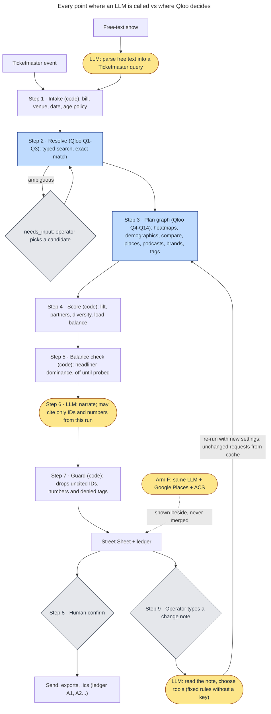

# Walkup

**The Fill-the-Room Agent.** *Fill the room, not the feed.*

Walkup is an agent for one booked show that still has seats to sell. Give it the show and it finds where this bill's crowd differs from the crowd the venue already reaches, ranks the local places that crowd already likes, and emails your street team the sheet after you confirm. Qloo decides which neighbourhoods and which places; Claude writes the sentences and turns your change notes into tool calls, and every claim on the sheet links to the request behind it.

> Your email list reaches people who already come to this room. Most of this bill's fans aren't on it; Walkup looks for the places they already go.

**Try it:** not hosted yet. [Run it yourself](#run-it-yourself-setup-from-a-clean-environment): sample mode needs no keys or signup.

**Status:** the whole pipeline runs end to end today on labelled sample data (a synthetic stand-in for Qloo, Ticketmaster and Google Places), with no keys. On Oct 15 2026 every request shape a run sends was checked against the live Qloo host ([what we found](#verified-on-hackathonapiqloocom-oct-15-2026)); no full live sheet has been recorded yet, so this page reports no live sheet results.

Contents: [The problem](#the-problem) · [What it does](#what-it-does) · [Qloo workflows and tools used, and why](#how-walkup-uses-qloo) · [A request, end to end](#a-request-end-to-end-redacted) · [What we checked](#what-we-checked) · [Screenshots](#screenshots) · [Run it yourself](#run-it-yourself-setup-from-a-clean-environment) · [Known limitations](#known-limitations-what-this-does-not-establish) · [Responsible by construction](#responsible-by-construction) · [How this differs](#how-this-differs) · [Where to look in the code](#where-to-look-in-the-code)

---

## The problem

A promoter or venue marketer has a show on sale, on a fixed date, with seats left. Every week before the show they decide where the street team goes, which local businesses get posters and ticket drops, which podcasts get a pitch, and what the ads say.

The usual inputs:

- **the venue's own email list**, which already reached the crowd that comes to this room;
- **paid social**, where a location radius is the main local control;
- **a street team working from memory** of what worked for other shows;
- **discounting**, which trains buyers to wait.

None of these answers the question that matters for this one show: *where does this bill's crowd differ from the room's usual crowd, and which real places nearby does that crowd already go to?* That needs aggregate taste data that connects an act to neighbourhoods and to specific local businesses. That is what Qloo has, and what Walkup uses.

## What it does

One run produces a **Street Sheet**: nine sections, each with a status (`ok`, `empty`, `needs_input`, `partial`, `degraded`, `error`), a reason when it isn't `ok`, and receipt numbers like `[Q9]` that open the exact request.

1. **Resolution.** The acts and the venue matched to Qloo entities, IDs shown. Ambiguity pauses the run and shows candidates; it is never guessed.
2. **Lift map: where this crowd differs from your house crowd.** The top 5 neighbourhood tiles where this bill's fans over-index versus the fans of the acts this room usually hosts, with the ZIPs in each tile.
3. **Partners for the drop.** 15-25 real places inside the top tiles (bars, cafes, book stores, barbershops...) with address, hours on the street-team day, phone, website and a "Why this place" line. Footer: *Suggested, not affiliated: no partner has agreed to anything.*
4. **Before and after the show.** 6-8 spots within 1.5 km of the venue, open on show night, load-balanced against assumed capacities you can edit. Alcohol rules come from the Ticketmaster age policy, never from Qloo.
5. **Media and sponsor.** 3-5 podcasts for a host-read or giveaway pitch (labelled local or national) and one sponsor brand (labelled national until local ranking is checked).
6. **Copy hooks.** Three lines built only from allowlisted Qloo tag words. No jokes, nothing in the artist's voice.

Supporting cards: **your own partner list in call order** (the operator's declared partners, scored by Qloo), **what's different tonight** (bill-versus-house tag contrast) and **bill-versus-house age and gender skew**.

**Change it in plain words.** Type a note about a finished sheet in the "Change something" box on the plan page, such as "All ages: no bars", "skip Germantown", "only Saturday" or "within 10 km" (or send it to `POST /api/plan/<id>/revise` or the MCP tool `revise_plan`). The note is turned into calls to five tools (mark the show all ages, leave out place types, skip areas on the sheet, set the street-team days, set the search radius from 5 to 60 km), the plan runs again with those settings, and you get a new sheet that lists what changed: settings, areas, partners and spots added or removed, each with receipts. Requests whose inputs didn't change are answered from the cache, so leaving out bars costs no new Qloo call. If the note is unclear, Walkup asks one question and changes nothing. All ages only adds restrictions: when Ticketmaster lists a show as 21+, that still holds, and the sheet treats it as all ages too (no bars, no alcohol in the copy lines, no alcohol, tobacco or gambling sponsor).

Then the action: **Send to street team** opens a confirm dialog listing recipients and attachments. Nothing is sent until you confirm. Exports: the PDF sheet, `partners.csv`, `zips.csv` and `pins.csv` for ad platforms, `street-team.ics`, `offer-codes.csv` (codes you create in your own ticketing platform) and `sheet.json` with the full ledger.

Three sample presets open from cache. Their bills are invented; only the rooms are real. **The Truth, Nashville** has two bills in the same room and two different maps. **Hampton Coliseum** is a three-act comedy bill where one act's one-word name matches several catalog entries, so the run stops and asks, and a thin act is seeded through a TV title. **Super Funny, Tacoma** is a small comedy club with thin signal and too short a roster to build its usual crowd; Qloo has no comedy-wide map to stand in, so the sheet has no lift map and says so, and partners are picked near the venue.

## How Walkup uses Qloo

### Qloo workflows and tools used, and why

Base URL `https://hackathon.api.qloo.com`, header `X-Api-Key`, server-side only. About **15 to 29 Qloo calls per fresh run** on the sample run (G1-A makes 29 cold, including the signal check, 4 split-half heatmaps and 3 partner usual-crowd searches that check the result; G3, with no lift map, makes 15). Each call gates one decision; each has a coded fallback whose reason shows on its card.

| Call | Request shape (abridged) | Decision it gates | Calls per run |
|---|---|---|---|
| Q1 | `GET /entities?external.spotify.ids=` from Ticketmaster attractions, else typed `GET /search?types=urn:entity:artist,urn:entity:person&take=5`, exact name match; then one signal check: `filter.type=urn:entity:place` with every seed as `signal.interests.entities`, `POINT(venue)`, 1,500 m, `take=1` | Whether the run proceeds and which acts are admissible seeds; ambiguity returns `needs_input` with candidates. An entry Qloo has no taste data for (a `not_found` warning) is swapped for the next usable entry of the same search, asked about, or left out, and the sheet says which | 2-5 (the check is one call per 25 ids, plus one per Spotify-matched act Qloo drops; a 200 is cached 7 days, a 400 is not) |
| Q2 | `GET /search?types=urn:entity:place` near the venue's coordinates, exact | The venue's place ID (excluded from partners; distance anchor). Not in the catalog yet: `POINT(lon lat)` from Ticketmaster | 1 |
| Q3 | The venue's next 60 Ticketmaster events, resolved via `GET /entities?external.spotify.ids=` | **The house set**: the room's top 12 resolved headliners. Fewer than 5: a pinned genre-tag baseline, `degraded`, but no genre tag is pinned yet (Oct 15), so today a short roster means no baseline (`baseline: "none"`) and no lift map; comedy never gets one | 1-3, weekly per venue |
| Q4 | `GET /v2/insights?filter.type=urn:heatmap&signal.interests.entities=<bill>&filter.location=POINT(lon lat)&filter.location.radius=40000` | Bill heat per geohash | 1 |
| Q5 | Same heatmap with the house set as the signal | House heat per geohash (the denominator of lift) | 0-1, weekly per venue |
| Q6 | Same heatmap with a pinned restaurant tag as the signal | Diagnostic: is lift just foot traffic? | 0-1 |
| Lift | No API call: `pct_rank(bill) / pct_rank(house)` per geohash-6, shrunk toward 1 where popularity is low | **Where** the street team goes and which tiles get partner searches | 0 |
| Q7 | `filter.type=urn:demographics` over bill and house (one block per entity) | Bill-versus-house age and gender skew for creative and dayparting. Never used for alcohol, radio format or community inference | 1 |
| Q8 | `GET /v2/analysis/compare?a.signal.interests.entities=<bill>&b.signal.interests.entities=<house>&take=30` | "What's different tonight"; side-`a` tags become copy-hook candidates. Generic result: two `urn:tag` calls diffed by rank, `degraded` | 1 (+2) |
| Q9 | `filter.type=urn:entity:place` per top tile: `signal.interests.entities=<bill>`, `filter.location=POINT(tile)` 2 km, pinned `filter.tags` with `operator.filter.tags=union`, `filter.hours=<street-team day>`, `filter.price_level.max=3`, `filter.exclude.tags`, `filter.exclude.entities=<venue>`, `feature.explainability=true`, `take=50` | **The 15-25 ticket-drop, poster and call partners** | 3 |
| Q10 | Same place shape at the venue, 1.5 km, restaurant/bar/cafe, show weekday; a weekly house-signal twin | The 6-8 pre/post spots and their "tonight versus usual" rank delta | 1 (+1 weekly) |
| Q11 | `filter.results.entities=<operator's partners>` with the bill as the signal | Call order for the operator's own list; partners not in the catalog stay on the list, "not in Qloo's catalog, kept in your order" | 1 (+1 pick-list search per typed partner, cap 20) |
| Q12 | `filter.type=urn:entity:podcast` with `signal.location=POINT(venue)`, explainability, `take=15` | Which podcasts get a pitch; labelled national until a check shows location moves the ranking | 1 |
| Q13 | `filter.type=urn:entity:brand` with `signal.location`, explainability, `take=15`; on shows that aren't 21+, brands whose name or tags point to alcohol, tobacco or gambling are left out (and pinned exclusion tags are sent once one exists) | One sponsor card, labelled national | 1 |
| Q14 | `filter.type=urn:tag` with `filter.tag.types=urn:tag:keyword:media,urn:tag:genre:music,urn:tag:theme:qloo,urn:tag:audience:qloo`, `diversify.by=subtype`, `take=30` | The copy allowlist, after the denylist | 1 |
| Q16 | `GET /v2/tags?filter.query=...&feature.semantic_search=true` | Pins tag IDs in [`config/tags.json`](config/tags.json) at build time; zero free-text tags at runtime | 0 at runtime |

**Request shapes a run uses:** typed `/search` with `needs_input`; `/entities` by external ID; a lift heatmap over a house baseline built from the venue's own roster; multi-block `urn:demographics`; `/v2/analysis/compare`; stacked-constraint place insights with explainability; `filter.results.entities` shortlist scoring; `signal.location` on podcasts and brands; `urn:tag` with namespace scoping and `diversify.by=subtype`. `/v2/tags` pins tag IDs ahead of time, never during a run. Every Qloo call is a GET with plain entity ids: weighted POST signals returned 400 on Oct 15, so nothing weights one act against another.

**The house baseline.** A raw heatmap mostly shows where people are: downtown wins for every audience. Walkup divides the bill's heat by the heat of the acts this room usually hosts, built from the venue's own upcoming Ticketmaster roster. What's left is where *this* bill's crowd over-indexes versus the room's usual crowd: the people the venue's list probably hasn't reached. Affinities are compared only as percentile ranks inside one response, never across calls. Two checks guard the map. If lift tracks general foot traffic too closely (Spearman above 0.9 against a restaurant heatmap), the map shows a `lift weak` badge. If lift ranks areas almost like the bill's own map (Spearman above 0.9), the card says the map shows where this crowd is, not where it stands out; a comedian's map against the restaurant baseline scored 0.98 on Oct 15. Either way, partners fall back to near-venue ranking.

**Deterministic scoring.** Partner score inside a tile is `(1 - (qloo_rank - 1) / n) × (tile lift / max lift)`, with at most 2 partners per category per tile, at least 1 non-bar per tile, at most 8 per tile, ties broken by distance, closed places dropped and hours checked against the street-team day. Code ranks; the model does not.

### Verified on hackathon.api.qloo.com, Oct 15 2026

Each request shape a run sends, checked against the live host on Oct 15 2026 (the day-one probes plus a few single checks). Only derived facts are listed: statuses, counts and field names, no response data. **Verified** means the shape answers as we use it; **changed** means the check changed what we send or how we read it; **added** is new because of a check; **removed** means the code path is gone.

| Request shape we send | Used for | What the live host did | Status |
|---|---|---|---|
| `GET /search` `types=urn:entity:artist,urn:entity:person`, `take=5`, exact name | Acts (Q1), the room's usual acts (Q3) | 200. Most musicians are listed twice under one exact name, an artist entry and a person entry; the run now counts them as one act | verified, changed |
| `GET /v2/insights` `filter.type=urn:entity:place`, the seeds as `signal.interests.entities`, `filter.location=POINT(venue)`, 1,500 m, `take=1` | Signal check (Q1): one call per 25 ids, plus one per Spotify-matched act Qloo drops (a 200 is cached 7 days, a 400 is not) | 200 with a top-level `not_found` warning naming each seed Qloo has no taste data for ("Jason Isbell" was one; "Jason Isbell and The 400 Unit" works) | added |
| `GET /search` `types=urn:entity:place`, `filter.location=<lat>,<lon>`, `filter.radius` in miles | Venue (Q2), pick list for your partners (Q11) | 200; a room was found 5 m from its point within 1 mile; another room is not in the catalog | verified |
| `GET /entities?external.spotify.ids=` | Acts and the room's roster by Spotify id (Q1, Q3) | 200; the ids come back under `properties.external`. The roster-wide check waits for the Ticketmaster key | verified, changed |
| `filter.type=urn:heatmap`, `signal.interests.entities`, `filter.location=POINT`, `filter.location.radius` | Bill and usual-crowd maps (Q4, Q5), the split-half check | 200; the radius is honoured; a seed Qloo has no taste data for is dropped with no warning, and a map of only such seeds still comes back (200, with cells), which is why the signal check exists | verified |
| `filter.type=urn:heatmap` with a pinned place tag (restaurant) as the signal | Popularity check (Q6) | 200 | verified |
| `filter.type=urn:heatmap` with a genre tag as the signal | Genre baseline when the roster is short (Q5) | The stand-up comedy tag returned 0 areas near a comedy club. Music genre tags are not checked yet, so none is pinned | changed: no comedy baseline |
| `filter.type=urn:demographics` | Age mix (Q7) | 200; one block per signal, 6 age buckets, 2 gender keys | verified |
| `GET /v2/analysis/compare` `a.signal.interests.entities`, `b.signal.interests.entities`, `take=30` | How this crowd differs (Q8) | 200; `take` has no effect, so each list is cut on our side | verified, changed |
| `filter.type=urn:entity:place` per area: `filter.location` and radius, `filter.tags` with `operator.filter.tags=union`, `filter.hours`, `filter.price_level.max`, `feature.explainability`, `take=50` | Partners (Q9) and their usual-crowd twin, spots near the venue (Q10) | 200; `filter.hours` is honoured (5 places closed that day without it, 0 with it). `filter.exclude.tags` and `filter.exclude.entities` are not checked yet | verified |
| `filter.tags` with pinned category tags | Partner and spot categories (Q9, Q10) | 11 of 14 categories pinned (5 to 10 places within 25 km, every one carrying the tag); record store, Irish pub and place of worship returned too few and are not used | verified, changed |
| `filter.results.entities` with the bill as the signal | Call order for your partners (Q11) | 200; a 10-entity shortlist came back fully scored | verified |
| `filter.type=urn:entity:podcast`, `signal.location=POINT(venue)`, `feature.explainability`, `take=15` | Podcasts (Q12) | 200, 15 rows with a usable seed. The day-one 400s came from a seed Qloo had no taste data for. Whether location moves the ranking is not shown, so podcasts stay labelled national | verified |
| `filter.type=urn:entity:brand`, `signal.location=POINT(venue)`, `feature.explainability`, `take=15` | Sponsor (Q13) | 200, 15 rows with a usable seed. No alcohol brand tag was found to exclude, so on shows that aren't 21+ a name and tag filter keeps alcohol, tobacco and gambling brands off | verified, changed |
| `filter.type=urn:tag`, `filter.tag.types`, `diversify.by=subtype`, `take=30` | Copy-line tags (Q14) | 200; `diversify.by=subtype` keeps at most 5 tags per namespace | verified |
| `GET /v2/tags` `filter.query`, `filter.parents.types=urn:entity:place`, `feature.semantic_search=true` | Pinning tag ids (build time) | 200 | verified |
| `POST /v2/insights` with `{entity, weight}` signals | Weighting an act against its stand-ins | 400 | removed |
| `filter.results.entities.query` (place names instead of ids) | Scoring a typed list without a pick list | 400 | removed, never sent |
| `signal.demographics.age` on place calls | Age-tuned partner ranking | No change in the top 10, but the test ran on a seed Qloo had no taste data for, so it shows nothing | removed, never sent |
| `GET /v2/audiences` `filter.query` | Declared group segments | 0 results for both test queries | removed |

### Every point where an LLM is called vs where Qloo decides



The LLM (`claude-opus-5-5`) is called at four points only: parsing free text into a Ticketmaster query, narrating the finished sheet, the fair-control arm, and reading a change note. For a change note it sees a short summary of the sheet (areas, place types, settings; no partner names or contacts) and chooses among strict tools whose allowed values come from that sheet; it can also ask one question instead. It never ranks places: the tools only set inputs, and the plan runs again through Qloo and the same code. Without an Anthropic key, or when the call fails, fixed rules read common notes ("all ages", "no bars", "skip <area>", "only Saturday", "within 10 km") into the same tool calls, the sheet says the rules read it, and anything else gets a question. Which places, which tiles and in what order is decided by Qloo plus deterministic code. Narration is schema-constrained: each field can reference only the entity IDs and numbers returned in this run, and a validator drops anything else and shows the count.

### Without Qloo

The **"Without Qloo"** list is the fair control, shown beside the Qloo list. On a live run with an Anthropic key it is the same model with the same system prompt and output schema, using Google Places Text Search and a Census ACS lookup as its tools. Without a model key, and in sample mode, fixed category searches ranked by Google rating stand in, and the sheet says so. The overlap is counted and the Qloo-only picks are marked. The app does not claim the control is worse; it shows where the two lists differ.

## A request, end to end (redacted)

No full live run has been recorded yet, so this section shows the shape of the core partner call (checked against the live host on Oct 15) and what the code does with the answer, not a recorded response.

```http
GET /v2/insights
  ?filter.type=urn:entity:place
  &signal.interests.entities=<bill entity IDs from Q1>
  &filter.location=POINT(<tile lon> <tile lat>)
  &filter.location.radius=2000
  &filter.tags=<pinned category URNs from config/tags.json>
  &operator.filter.tags=union
  &filter.hours=<street-team weekday>
  &filter.price_level.max=3
  &filter.exclude.entities=<venue entity ID from Q2>
  &feature.explainability=true
  &take=50
Host: hackathon.api.qloo.com
X-Api-Key: $QLOO_API_KEY
```

From each row of `results.entities` the code reads the entity ID, name, location, tags, `query.affinity`, `query.distance`, `query.explainability` and the `hours`, `is_closed`, `address`, `phone` and `website` properties. Closed places and places shut on the street-team day are dropped and counted, denied tags are stripped, and the rest are scored inside their tile with the diversity rules above. The ledger keeps the request with the key replaced by `$QLOO_API_KEY`, the status, latency, result count and cache flag, and every partner on the sheet points back to it as `[Qn]`.

The field-by-field mapping from our inputs to Qloo parameters and back is in [docs/mapping-table.md](docs/mapping-table.md).

## What we checked

- **Product eval, 20 cases, on sample data.** Four goldens and sixteen scenario cases (the `needs_input` pause, thin heatmaps, empty compare, closed places, missing hours, the all-ages rule, quota and rate limits and more) run end to end through the orchestrator on the synthetic stand-in, with grounding, ledger, budget and policy checks on every sheet. All 20 pass; CI writes the score to [`evals/product/out/score.md`](evals/product/out/score.md). This checks that the pipeline behaves as described. It says nothing about whether Qloo's picks are better than another list.
- **P1, the Fan-Bar Test: designed and sealed, not run.** The question was whether a supporters' club, used as a Qloo signal, ranks that club's official home bar in each US metro above a popularity ranking of the same places and above the same model searching Google Places. The analysis plan was hashed before any data existed ([`docs/preregistration/`](docs/preregistration/)), and the collector, analysis code and their tests on synthetic data are in [`evals/p1/`](evals/p1/). A full run needs up to 1,331 Qloo calls, more than a tenth of a monthly key, so we chose not to run it. There is no P1 result.

What we tried and dropped is in [docs/what-we-tried.md](docs/what-we-tried.md).

## Screenshots

None yet. They will come from a live run and will show no credentials or personal data:

1. The first screen: two bills in the same room, side by side, with named tiles.
2. The "Without Qloo" list beside the Qloo list, overlap marked.
3. The receipt drawer: a partner's `[Q9]` link opens the request with its parameters and copy-as-curl.
4. `needs_input` and thin signal, on a phone: the candidate picker and the policy-denied tag count.
5. The Street Sheet PDF, page 1.
6. Confirm and send: recipients, Confirm, the ledger entry.
7. The agent skill in a terminal returning a sheet link and the JSON envelope.

## Run it yourself (setup from a clean environment)

Requirements: **Node 22+** and npm. Python 3.11 only for the evals.

```bash
git clone <this repository> walkup
cd walkup
npm ci
cp .env.example .env        # Windows: copy .env.example .env
npm run dev                 # http://localhost:3000
```

**Sample mode works with no keys.** With `WALKUP_MODE=auto` (the default) and blank keys, the four preset shows run end to end through the same orchestrator on a synthetic stand-in for Qloo, Ticketmaster and Google Places (`packages/qloo-world`, no network). Every page, file and email is marked as sample (fixture) data, and free-form show search is disabled with an explanation. To run live, fill in `.env`:

| Variable | Used for | Without it |
|---|---|---|
| `QLOO_API_KEY` | Every Qloo call. Server-side only, never sent to the browser | Sample mode |
| `QLOO_BASE_URL` | Defaults to `https://hackathon.api.qloo.com` | |
| `TICKETMASTER_API_KEY` | Event lookup, venue coordinates, age policy, venue roster | Sample mode |
| `GOOGLE_PLACES_API_KEY` | The fair-control arm and grounding checks only | No "Without Qloo" list |
| `CENSUS_API_KEY` | Live ACS lookups (`packages/acs`) | Adult counts come from the bundled gazetteer; the Census API redirected keyless requests to a missing-key page in October 2026, so live ACS calls need the (free) key |
| `ANTHROPIC_API_KEY` | Narration, free-text parsing, the fair-control arm | Narration falls back to a labelled template; the fair control uses fixed searches |
| `RESEND_API_KEY`, `RESEND_FROM` | The confirm-gated send | The preview and the ledger entry are real, but nothing is sent ("demo: not sent") |

Checks (the same ones CI runs):

```bash
npm run typecheck
npm test
node --test "skills/test/*.test.mjs" "config/test/*.test.mjs"
node scripts/check-no-raw.mjs           # no Qloo response bodies in the tree
python -m pip install -r evals/requirements.txt && python -m pytest evals
```

**From an agent.** [`skills/walkup/`](skills/walkup/SKILL.md) is an Agent Skill (OpenClaw-compatible) with a small CLI: `plan`, `rank-partners`, `sheet --pdf`. It talks to a Walkup server at `WALKUP_URL` and never handles a Qloo key. The same server serves MCP tools at `/mcp` (`plan_show`, `rank_partners`, `bill_vs_house`, `get_sheet`, `revise_plan`; see [`packages/mcp`](packages/mcp/README.md)).

## Known limitations: what this does not establish

Printed on every Street Sheet:

- **Whether this plan sells tickets:** nothing here measures sales.
- **What fans will buy:** these are tastes, not purchases.
- **Where buyers live:** the areas show where this bill's fans stand out from the room's usual crowd.
- **Anything about one person, or whether a partner will move tickets.**

Also:

- **Thin signal.** Comedians, small acts and smaller metros can return sparse heatmaps or few places. Cards then show `partial` or `degraded` with the reason, and the sheet says "thin signal: treat as a starting list". Film or TV titles stand in only for an act Qloo has little on.
- **Comedy has no genre baseline.** On Oct 15 the stand-up comedy tag map came back empty near a comedy club, so a comedy room whose roster resolves fewer than 5 comedians gets no lift map, and partners are picked near the venue. No music genre baseline is pinned yet either: none has been checked.
- **Qloo can list an act it has no taste data for.** The signal check catches it before planning and the sheet names the swap. If Qloo still ignores every seed on a later call, that card leaves the list out rather than show general popularity as this bill's list.
- **New venues.** A room that opened recently may not be a Qloo place yet; the run uses the Ticketmaster coordinates as a `POINT` and says so. Partners do not depend on the venue entity.
- **Generic compare results.** When bill-versus-house compare returns only shared, generic tags, the card falls back to a tag diff and is marked `degraded`.
- **Local or national.** Podcast and brand rankings with `signal.location` may not move with location; when they don't, they are labelled "national, not local".
- **No live sheet yet.** Every sheet today is sample data. The Oct 15 checks show which request shapes work on the live host, not that Qloo's picks beat a popularity ranking or the fair control.
- **The fair control is a fair control, not every alternative.** It excludes Google Trends and Spotify's top cities because neither has an official API.
- **Revisions change five settings only.** All ages, place types, areas, street-team days and radius. A note asking for anything else gets a question back. The fixed rules know a short list of phrasings; the model reads more, but only when an Anthropic key is set, and in sample mode the rules always read the note.
- **Counts are what-ifs.** Seats left and capacity are operator inputs, marked as what-ifs wherever they appear. The presets carry no seats-left count. No sales data about any show is known or shown.

## Responsible by construction

- **What we store and what we don't.** No fan, buyer or viewer data. No login, no personal data, no cookies beyond one functional cookie. The optional "send a copy to me" address is used once and never stored. Qloo response bodies live only in a private, git-ignored cache; a CI check fails the build if one lands in the tree. The ledger keeps request parameters with the key replaced by `$QLOO_API_KEY`.
- **Inputs are the show, not people.** The bill, the venue, the date and what the operator types: counts, a radius, street-team days, a partner list. "Already reached" ZIPs are aggregate counts from the operator's own report, with no names.
- **Declared, never inferred.** Community channels (alumni chapters, congregations, barbershops the promoter already works with) appear only when the operator types them, and are ranked as places on that list. Lift is always said against a named baseline ("about 1.8 times the room's usual crowd"), never as where a group lives.
- **Denylist in code, tested in CI.** Tags in the ethnicity, inclusivity, credit-card, hotel-rating, cost-description, Wikipedia-category, religion, political, sexuality and customer-identity namespaces, and tags whose names carry identity, religion or health terms, never reach copy or stored data (see `DENIED_TAG_PREFIXES` in [`packages/contracts`](packages/contracts/src/index.ts), mirrored in [`config/tags.json`](config/tags.json)). Person-entity tags are stripped before anything is persisted.
- **No proxy inference.** No radio format from demographics. Age policy and alcohol rules come from Ticketmaster's `ageRestrictions`, never from Qloo skews; no alcohol brands on fan-facing pages unless the show is 21+.
- **Confirm gates.** Every send waits for an explicit confirm, defaults to a test inbox, and goes only to addresses the operator typed. Partners are always "suggested, not affiliated". Promo codes are created by the box office in its own ticketing platform; we only export a suggested list.
- **Real shows, public facts.** No show is ever labelled "soft" or "tracking", and there is no public ranking of shows. Generated copy has no jokes, no artist voice, no likeness. Candidate and campaign events are refused.

Details: [System Card](docs/system-card.md).

## How this differs

Other public 2026 projects built on Qloo work on nearby problems. Descriptions are of what each project does, from its public pages.

| Project | What it does | How Walkup differs |
|---|---|---|
| Theme Night GM | Turns a sports team's weaker home dates into theme-night kits: a heatmap near the venue, places within 6 km, a sponsor, with the league as the fan proxy | Starts from one already-booked show and compares that bill against the room's own roster; ranks partners per lift tile; scores the operator's own list; produces a street-team sheet and a confirm-gated send |
| Routed, Advance, Booker, Opener, Roomtone | Choosing where and with whom to play: cities, rooms, supporting acts; promoter advance briefs | Starts after those choices: the date, room and bill are fixed, and the remaining seats are the problem |
| Fanroute | Poster spots ranked by the act's affinity | Lift against the house crowd, a live fair control, grounding checks, the operator's declared partners scored, and a confirm-gated send |
| Tasteplot | Site selection using heatmap lift over a baseline audience | A dated show and a weekly street-team decision, not a lease |

## Where to look in the code

| Path | What's there |
|---|---|
| [`packages/contracts/`](packages/contracts/src/index.ts) | Shared types: envelope, ledger, entities, lift tiles, Street Sheet cards, policy constants |
| [`packages/qloo/`](packages/qloo/) | Qloo client: request shapes Q1-Q16, rate limiter, month guard, private cache, ledger writer, fixture record and replay |
| [`packages/engine/`](packages/engine/) | Pure code, no I/O: lift, partner scoring, diversity rules, load balancer, budget heuristic, guard, denylist |
| [`packages/narrator/`](packages/narrator/) | Schema-constrained narration and the labelled template fallback |
| [`packages/tm/`](packages/tm/) | Ticketmaster Discovery: intake, venue roster, age policy |
| [`packages/places/`](packages/places/) | Google Places (New) for the fair-control arm and grounding checks |
| [`packages/acs/`](packages/acs/), [`packages/gazetteer/`](packages/gazetteer/) | Census ACS lookups; neighbourhood and ZCTA naming for tiles |
| [`apps/web/`](apps/web/) | Next.js app: Street Sheet, map, receipt drawer, confirm dialog, exports |
| [`config/tags.json`](config/tags.json) | Pinned Qloo tag URNs (see [`config/README.md`](config/README.md)) |
| [`skills/walkup/`](skills/walkup/SKILL.md) | Agent Skill and CLI |
| [`evals/`](evals/), [`docs/preregistration/`](docs/preregistration/) | The product eval; the sealed P1 plan and its analysis code (designed, not run) |
| [`scripts/`](scripts/) | Probe script, no-raw-bodies check |
| [`docs/`](docs/) | [Spec and acceptance criteria](docs/spec.md), [System Card](docs/system-card.md), [mapping table](docs/mapping-table.md), [what we tried](docs/what-we-tried.md) |

## License

MIT. See [LICENSE](LICENSE). Data from Qloo, Ticketmaster, Google, OpenStreetMap contributors (ODbL, via OpenFreeMap) and the US Census Bureau is used under each provider's terms and attributed in the app.
